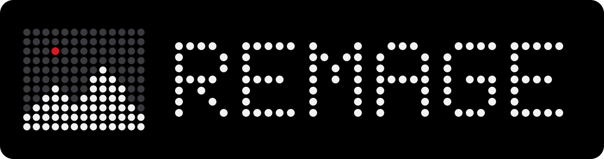
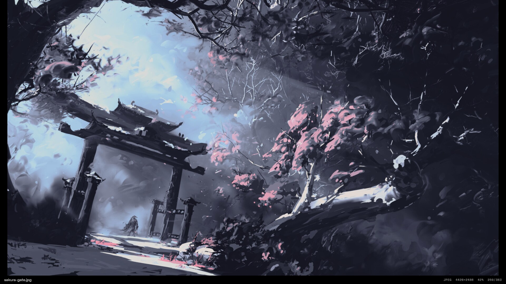
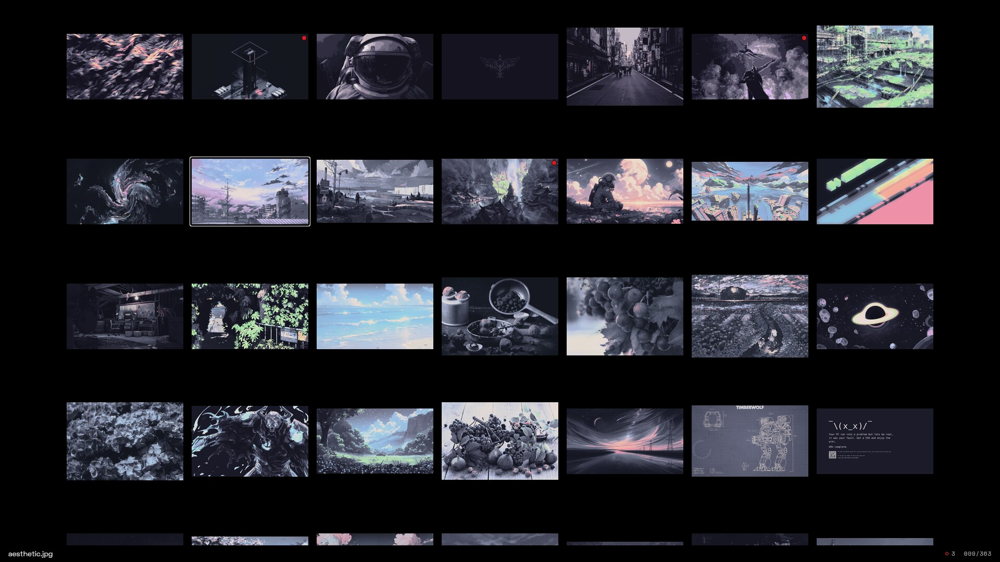
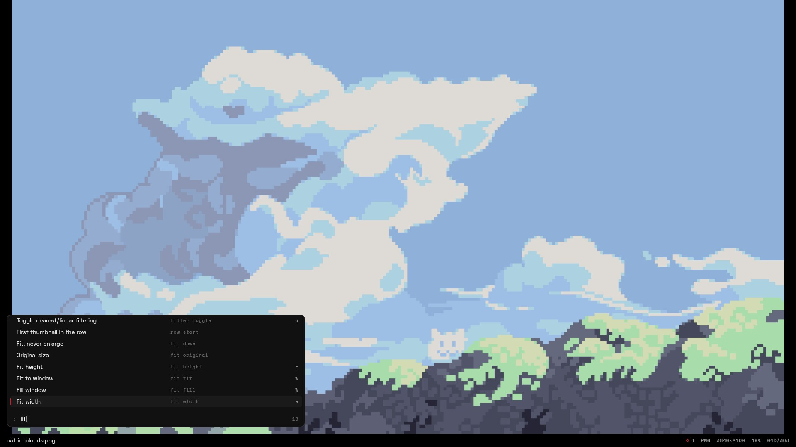

<div align="center">
  
  <p>A keyboard-centric image viewer for Linux. Fast, quiet and vim-shaped.</p>

[](https://github.com/krolyxon/remage/actions/workflows/ci.yml)
[](https://github.com/krolyxon/remage)
[](src)
[](LICENSE)
[-333333?style=flat-square&labelColor=000000)](#install)
[](https://wgpu.rs)
[](https://github.com/krolyxon/remage/commits)

</div>

remage aims for nsxiv's feature set with vim-style control and a Nothing OS look. It draws with the
GPU, so zooming, panning and scrolling stay smooth, and it uses no CPU at all while the picture
stands still. It can take its colours from your wallpaper through matugen or pywal, and you script
it with plain shell commands and an IPC socket.

<p align="center">
  
</p>

<table>
  <tr>
    <td width="50%"></td>
    <td width="50%"></td>
  </tr>
  <tr>
    <td align="center"><sub>Thumbnail grid with marks</sub></td>
    <td align="center"><sub><code>:</code> command palette</sub></td>
  </tr>
</table>

-----

## Features

- **Fast.** The first image is on screen in about 90 ms. Neighbours are decoded and uploaded ahead
  of time, so `n` and `p` take a single frame. Rendering happens only on demand.
- **Keyboard first.** Vim key notation, sequences (`gg`, `<Space>w`) and counts (`5n`, `12G`).
  Every feature is an action you can bind, run from the `:` palette or send over IPC. Which-key
  shows what a pending prefix can do, and `?` lists the live keymap.
- **Thumbnail grid.** Shares the freedesktop thumbnail cache with your file manager, so thumbnails
  are often there already. Visual mode marks ranges.
- **Many formats.** JPEG, PNG/APNG, GIF, WebP, JPEG XL, AVIF, HEIC, SVG, TIFF (multi-page), camera
  RAW, OpenEXR/HDR and more. Animations play with their own timing. ICC colour profiles and EXIF
  orientation are applied, and images larger than the GPU's texture limit are tiled. Anything
  else can go through an external decoder such as ImageMagick.
- **Scripting.** User commands replace nsxiv's key-handler: placeholders, marks as targets, inline
  confirmation and output fed back as actions. An old key-handler works unchanged.
- **IPC.** `remage msg next`, `remage msg --query marked` and `remage msg --subscribe image` from
  Hyprland binds or scripts.
- **Themeable.** Three colours are enough, and the rest are derived. matugen and pywal recolour
  open windows live when the wallpaper changes.
- **Configurable.** One TOML file with live reload, `file:line:col` errors and "did you mean"
  suggestions.

## Install

### Arch Linux

A `remage-git` PKGBUILD lives in [`contrib/PKGBUILD`](contrib/PKGBUILD):

```bash
git clone https://github.com/krolyxon/remage
cd remage/contrib
makepkg -si
```

It installs the binary, the man page, zsh/bash/fish completions and a desktop file.

### From source

You need stable Rust (1.96 or newer). AVIF and HEIC use two system libraries:

```bash
sudo pacman -S dav1d libheif                  # Arch
sudo apt install libdav1d-dev libheif-dev     # Debian/Ubuntu (libheif ≥ 1.17)

cargo install --locked --git https://github.com/krolyxon/remage
```

Without those libraries, build with the pure-Rust formats only:

```bash
cargo install --locked --git https://github.com/krolyxon/remage --no-default-features --features jxl,svg,raw
```

Shell completions and the man page are generated by the binary:

```bash
remage completions zsh > ~/.local/share/zsh/site-functions/_remage   # also bash, fish, elvish
remage man > ~/.local/share/man/man1/remage.1
```

## Usage

```bash
remage                      # the current directory
remage photo.jpg            # photo.jpg and the rest of its directory
remage -rt ~/Pictures       # a whole tree, starting in the grid
remage -S=3 wallpapers/     # slideshow, 3 seconds per image
find . -name '*.png' | remage -i -o > picked.txt   # pick images, print the marked ones on exit
remage --dump-config        # the complete commented default config
```

`remage --help` lists every option, and `man remage` covers keys, actions and IPC.

## Keys

The defaults below can all be changed. `?` shows the live keymap inside remage.

| | Keys |
|---|---|
| **Everywhere** | `n`/`p` next/previous · `[`/`]` ±10 · `gg`/`G`/`12G` first/last/goto · `<CR>` image ⇄ grid · `m` mark · `M` invert marks · `u` unmark all · `N`/`P` next/previous mark · `f` fullscreen · `b` status bar · `i` info · `s` slideshow · `r` reload · `D` remove from queue · `:` palette · `/` search · `?` help · `q` quit |
| **Image** | `hjkl` pan · `HJKL` jump to edge · `+`/`-`/`=` zoom in/out/100% · `w`/`W`/`e`/`E` fit/fill/width/height · `z` centre · `<`/`>` rotate · `\|`/`_` flip · `a` pixel filter · `A` transparency background · `{`/`}` gamma · `<C-Space>` play/pause · `<C-n>`/`<C-p>` frames · wheel zooms at the cursor, drag pans |
| **Grid** | `hjkl` move · `<C-d>`/`<C-u>` half page · `<C-f>`/`<C-b>` page · `0`/`$` row start/end · `+`/`-` thumbnail size · `v` visual mode, then `m` to mark the range · click selects, double-click opens |

## Configuration

remage reads `~/.config/remage/config.toml`. The file is merged over the built-in defaults, so put
in only what you change. Edits apply as soon as you save, and `remage --check-config` validates
the file. [`contrib/config.example.toml`](contrib/config.example.toml) is a good start.

```toml
[image]
fit = "down"                 # down | fit | fill | width | height | original
alpha_background = "dots"    # dots | checker | solid

[grid]
size = 160

[keys.image]
"<C-ScrollUp>" = "next"
"D" = "none"                 # remove a default binding
```

### Commands

Commands run asynchronously and act on the marked files, or on the current one when nothing is
marked. Bind them as `run <name>`; unbound ones still show up in the `:` palette.

```toml
[commands.delete]
desc    = "Delete files"
run     = ["rm", "--", "{files}"]          # array: run directly, {files} becomes one arg per file
confirm = "Delete {count} file(s)?"        # asks inline in the status bar: y / n

[commands.copy]
desc = "Copy image"
run  = "wl-copy --type image/png < {file}" # string: run through sh, placeholders are quoted

[commands.legacy]                          # an nsxiv key-handler works as it is
run   = ["~/.config/nsxiv/exec/key-handler", "w"]
stdin = "files"

[keys.global]
"<Space>d" = "run delete"
"<Space>c" = "run copy"
```

After a command succeeds, remage re-checks the files it touched by default. Deleted files leave
the queue and edited ones are decoded again, so delete and rotate scripts need no extra setup.
With `output = "actions"`, each line the command prints runs as an action.

### Theming

`nothing-dark` (the default) and `nothing-light` are built in. Any theme needs only `background`,
`foreground` and `accent`; the other tokens are derived.

- **matugen:** copy [`contrib/matugen/remage.toml`](contrib/matugen/remage.toml) into your matugen
  templates (the file says how), then add `include = ["~/.cache/matugen/remage.toml"]` to your
  config. Every wallpaper change recolours open windows.
- **pywal:** set `[theme] pywal = "~/.cache/wal/colors.json"`.

## Scripting over IPC

Each instance listens on `$XDG_RUNTIME_DIR/remage/<pid>.sock` and speaks newline-delimited JSON.
`remage msg` talks to the newest instance (or `$REMAGE_SOCKET`, or `--pid`).

```bash
remage msg next 5                     # any action
remage msg --query marked             # current | marked | queue | state
remage msg --subscribe image          # one JSON line per change

# Hyprland
bind = SUPER, bracketright, exec, remage msg next
```

## Formats

| Format | Through |
|---|---|
| JPEG, PNG/APNG, GIF, WebP, BMP, ICO, TIFF, TGA, PNM, QOI, DDS, HDR, OpenEXR | `image` |
| JPEG XL | `jxl-oxide` |
| AVIF | `dav1d` (system library) |
| HEIC / HEIF | `libheif` (system library) |
| SVG / SVGZ | `resvg`, re-rendered sharp at every zoom level |
| Camera RAW (CR2, CR3, NEF, ARW, DNG, RAF, ORF, RW2 …) | `rawler`, embedded preview first |
| Anything else | `[[decoders]]`, e.g. `magick "{file}[0]" png:-` for PSD and XCF |

## Development

```bash
cargo run --release -- ~/Pictures
cargo fmt --check && cargo clippy --all-targets -- -D warnings && cargo test
RUST_LOG=remage=debug cargo run --release   # startup and first-frame timings
REMAGE_SNAPSHOT=/tmp/x.png remage …          # also write each settled frame to a PNG
```

`tests/fixtures/make.sh` regenerates the decoder fixtures.

## License

remage is licensed under the [GNU AGPL v3](LICENSE). The embedded fonts (Space Grotesk, Space
Mono and Doto) are under the [SIL Open Font License](assets/fonts/OFL.txt).
